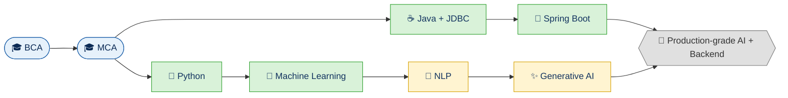

<div align="center">


<a href="https://github.com/vaishnavi19-h">
  
</a>

<br/>


</div>

---

## 🪟 Welcome.exe

> ```text
> ┌──────────────────────────────────────────────────────────┐
> │ 🖥️  Welcome to Vaishu's Desktop                 ─  □  ✕ │
> ├──────────────────────────────────────────────────────────┤
> │                                                          │
> │   User      :  Vaishu  (vaishnavi19-h)                   │
> │   Edition   :  MCA + BCA Graduate                        │
> │   Role      :  Java Developer | AI/ML Enthusiast         │
> │   Status    :  ● Online · Learning · Building            │
> │   Mission   :  Build smart, useful, real-world software  │
> │                                                          │
> │                          [  OK  ]   [ Cancel ]           │
> └──────────────────────────────────────────────────────────┘
> ```

---

## 🎮 Player Card

<div align="center">

| 🎯 Stat | 📊 Value |
|:--|:--|
| **Player Name** | Vaishu |
| **Class** | Full-Stack Java Developer + AI Engineer |
| **Education** | 🎓 BCA → MCA (Completed) |
| **Primary Weapons** | Java ☕ · Python 🐍 · SQL 🗄️ |
| **Special Powers** | Machine Learning · NLP · Generative AI |
| **Current Quest** | Building production-grade AI + backend projects |
| **Level** | ⭐⭐⭐⭐☆ *(and always levelling up)* |

</div>

---

## 🧰 Skill Tree

<table>
<tr>
<td width="50%" valign="top">

### 🪟 `Backend.dll`


</td>
<td width="50%" valign="top">

### 🪟 `Intelligence.dll`


</td>
</tr>
</table>

### ⚡ XP Progress Monitor

<div align="center">
  
</div>

---

## 🏆 Featured Quests (Core Projects)

<table>
<tr>
<td width="50%" valign="top">

### 🇮🇳 Quest 01: SwachhBharat
`Status: ✅ Completed`

A project built around the **Swachh Bharat** (Clean India) theme, using real software engineering to support cleanliness and civic awareness.

[](https://github.com/vaishnavi19-h/SwachhBharat)

</td>
<td width="50%" valign="top">

### ❤️ Quest 02: Heart Disease Prediction
`Status: ✅ Completed`

A **machine learning** project that predicts the likelihood of heart disease from patient health data, showing how AI can help in healthcare.

[](https://github.com/vaishnavi19-h/Heart-disease-prediction)

</td>
</tr>
</table>

<div align="center">

<a href="https://github.com/vaishnavi19-h/SwachhBharat"></a>
<a href="https://github.com/vaishnavi19-h/Heart-disease-prediction"></a>

</div>

---

## 🗺️ Skill Roadmap (World Map)



> 🟢 Unlocked &nbsp;·&nbsp; 🟡 In progress &nbsp;·&nbsp; ⚪ Final boss

---

## 🏅 Achievements Unlocked

| Badge | Achievement | Status |
|:--:|:--|:--:|
| 🎓 | **Scholar**: completed BCA + MCA | ✅ Unlocked |
| ☕ | **Java Knight**: built projects with Java, JDBC & Spring Boot | ✅ Unlocked |
| 🧠 | **ML Apprentice**: trained and shipped a prediction model | ✅ Unlocked |
| 💬 | **Word Wizard**: working with NLP | 🔄 In progress |
| 🤖 | **GenAI Explorer**: building with Generative AI | 🔄 In progress |
| 🚀 | **Production Hero**: ship a large-scale AI product | 🔒 Locked |

<div align="center">


</div>

---

## 📊 GitHub Stats Dashboard

<div align="center">


<br/>


</div>

### 🐍 Contribution Snake

<div align="center">

<picture>
  <source media="(prefers-color-scheme: dark)" srcset="https://raw.githubusercontent.com/vaishnavi19-h/vaishnavi19-h/output/github-snake-dark.svg" />
  <source media="(prefers-color-scheme: light)" srcset="https://raw.githubusercontent.com/vaishnavi19-h/vaishnavi19-h/output/github-snake.svg" />
  
</picture>

</div>

---

## 🗺️ Current Mission Log

```text
C:\Users\Vaishu> status --current

  [■■■■■■■■□□]  Deepening Spring Boot + REST API skills
  [■■■■■■■□□□]  Exploring Generative AI & LLM applications
  [■■■■■■□□□□]  Sharpening NLP techniques
  [■■■■■■■■■□]  Writing clean, documented code
```

---

## 🪟 Start Menu

<details>
<summary><b>🧰 All Programs (click to expand)</b></summary>

<br/>

| Program | Category | Purpose |
|:--|:--|:--|
| ☕ **Java** | Language | Core backend development |
| 🍃 **Spring Boot** | Framework | REST APIs and web applications |
| 🗄️ **JDBC + SQL** | Database | Data access and queries |
| 🐍 **Python** | Language | ML, NLP and automation |
| 🤖 **Machine Learning** | AI | Prediction models (e.g. heart disease) |
| 💬 **NLP** | AI | Working with text and language |
| ✨ **Generative AI** | AI | LLM-powered applications |

</details>

<details>
<summary><b>🎯 Fun Facts (click to expand)</b></summary>

<br/>

- 🎓 Completed both **BCA and MCA**
- 🇮🇳 Built a project inspired by **Swachh Bharat**
- ❤️ Trained an ML model to predict **heart disease**
- 🚀 Always learning, always shipping

</details>

<details>
<summary><b>🔧 Settings: Currently open to</b></summary>

<br/>

- 💼 Java / Spring Boot developer roles
- 🤖 AI / ML / GenAI projects and internships
- 🤝 Open-source collaboration

</details>

---

## 📬 Contact Panel

<div align="center">

> ```text
> ┌────────────────────────────────────────────┐
> │  📬 Contact                        ─  □  ✕ │
> ├────────────────────────────────────────────┤
> │   Let's collaborate on something great!    │
> └────────────────────────────────────────────┘
> ```

[](https://github.com/vaishnavi19-h)
<!-- Add your own links below, then remove these comment markers:
[](https://linkedin.com/in/YOUR-ID)
[](mailto:YOUR-EMAIL)
-->

</div>

---

<div align="center">
  
  <br/>
  
</div>
